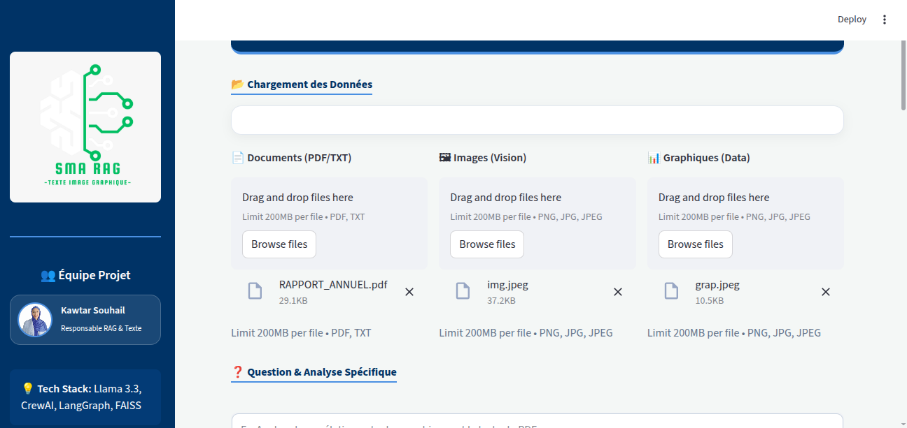
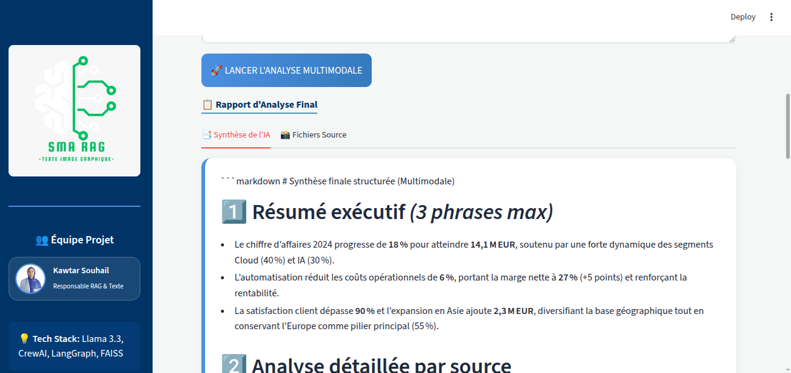
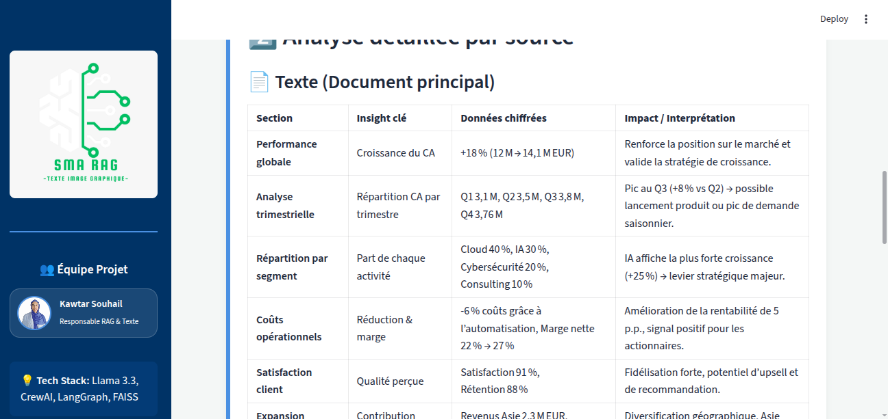
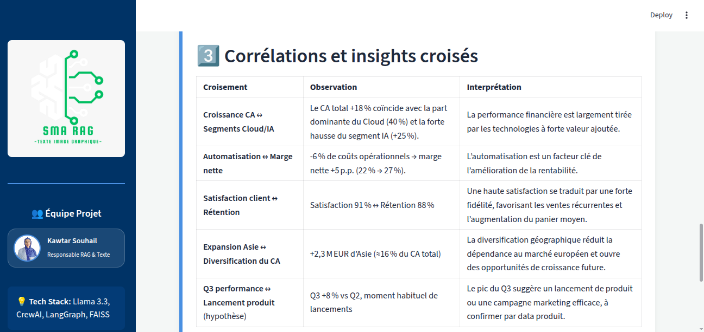

# RAG Multimodal Multi-Agent

Système multi-agents qui analyse des **documents (PDF/TXT)**, des **images** et des **graphiques** pour répondre à une question, puis produit une **synthèse structurée en Markdown**.

Construit avec **LangGraph** (orchestration), **CrewAI** (synthèse multi-agents), **FAISS** (RAG) et **Groq** (LLM et vision), avec une interface **Streamlit**.

---

## 🖼 Exemple d'utilisation

**Scénario :** on charge un PDF, une image et un graphique, puis on pose la question
*« Analyse la corrélation entre les graphiques et le texte du PDF »*.

| 1. Chargement des fichiers | 2. Question de l'utilisateur |
|:---:|:---:|
|  |  |
| Documents, images et graphiques déposés dans l'interface. | Question en langage naturel, ou analyse complète par défaut. |

| 3. Routage et analyse | 4. Rapport final |
|:---:|:---:|
|  |  |
| Le routeur choisit les agents ; le RAG et les modèles de vision analysent chaque source. | Synthèse multimodale produite par les agents CrewAI. |

---

## 🏗 Architecture

```
User Input
     ↓
Router (LLM)             → décide quels agents activer
     ↓
Retriever (RAG, FAISS)   → passages pertinents des documents
     ↓
Graph Analyzer (Vision)  → type, axes, valeurs et tendances
     ↓
Image Analyzer (Vision)  → objets, texte visible, contexte
     ↓
Synthèse multi-agents (CrewAI)
     ↓
Rapport multimodal final (Markdown)
```

1. **Router** : choisit `retriever`, `graph` et/ou `image` selon la question et les fichiers fournis.
2. **Retriever** : découpe les documents en passages, les indexe dans FAISS et récupère les plus proches de la question.
3. **Graph / Image Analyzer** : un modèle de vision analyse chaque fichier de façon indépendante.
4. **Synthèse CrewAI** : un analyste extrait les informations clés, puis un synthétiseur rédige le rapport final.

---

## ⚙️ Technologies

| Rôle | Outil |
|---|---|
| Orchestration | LangGraph |
| Agents de synthèse | CrewAI |
| Indexation vectorielle | FAISS |
| Embeddings | HuggingFace `all-MiniLM-L6-v2` |
| Routeur | Groq `llama-3.1-8b-instant` |
| Vision | Groq `llama-4-scout-17b-16e-instruct` |
| Synthèse | Groq `gpt-oss-120b` |
| Interface | Streamlit |
| Langage | Python 3.12 |

---

## 📂 Structure du projet

```
rag-multimodal-multi-agent/
├── app.py              # Interface Streamlit
├── ragproject.py       # Pipeline LangGraph + CrewAI + RAG
├── docs/               # Captures d'écran (rag1.png ... rag4.png)
├── requirements.txt
├── .env.example        # Modèle de variables d'environnement
└── README.md
```

---

## 🚀 Installation et lancement

```bash
git clone https://github.com/kawtarsouhail/rag-multimodal-multi-agent.git
cd rag-multimodal-multi-agent
python3.12 -m venv .venv
source .venv/bin/activate
pip install -r requirements.txt
cp .env.example .env      # puis renseigne ta clé
streamlit run app.py
```

Variable d'environnement requise dans `.env` :

```
GROQ_API_KEY=ta_cle_groq
```

Une clé gratuite est disponible sur [console.groq.com](https://console.groq.com/). Ne commite jamais ton fichier `.env`.

---

## 👩‍💻 Auteure

**Kawtar Souhail** · [Portfolio](https://kawtar-portfolio-ten.vercel.app/) · [LinkedIn](https://www.linkedin.com/in/kawtar-souhail-44a969250) · [GitHub](https://github.com/kawtarsouhail)
